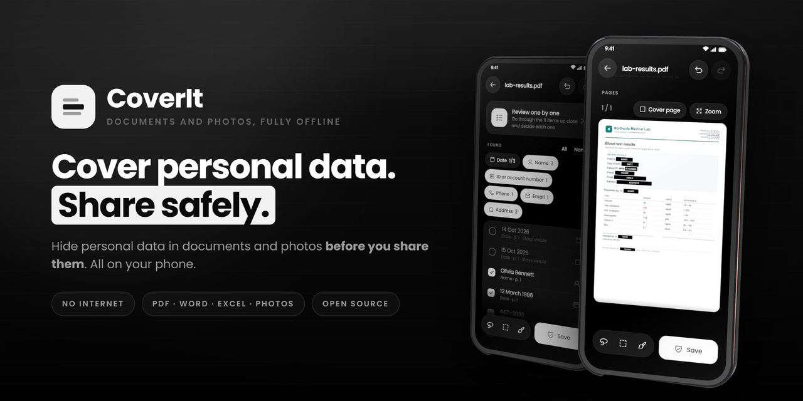
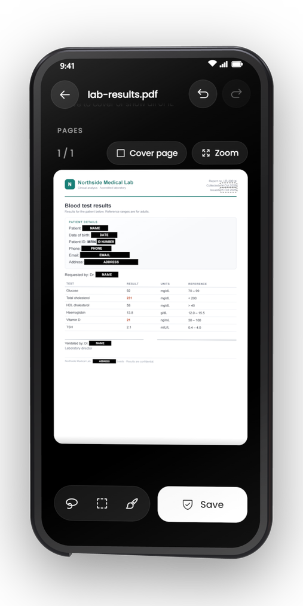
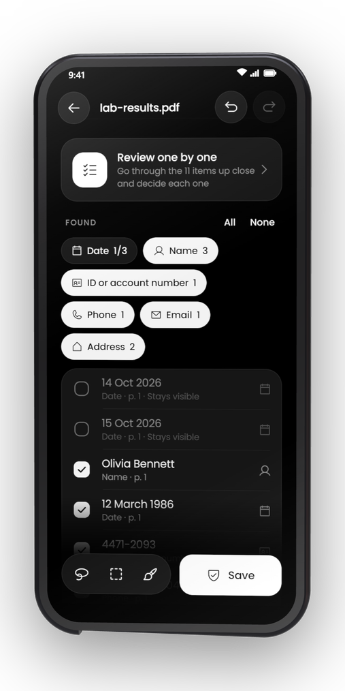
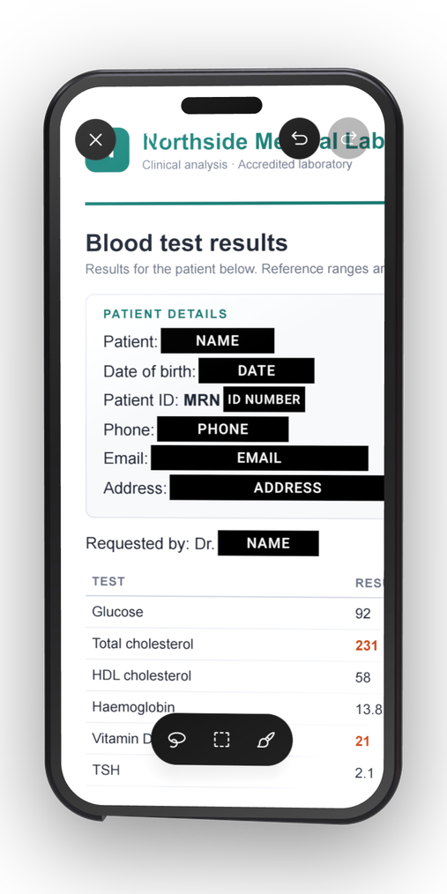
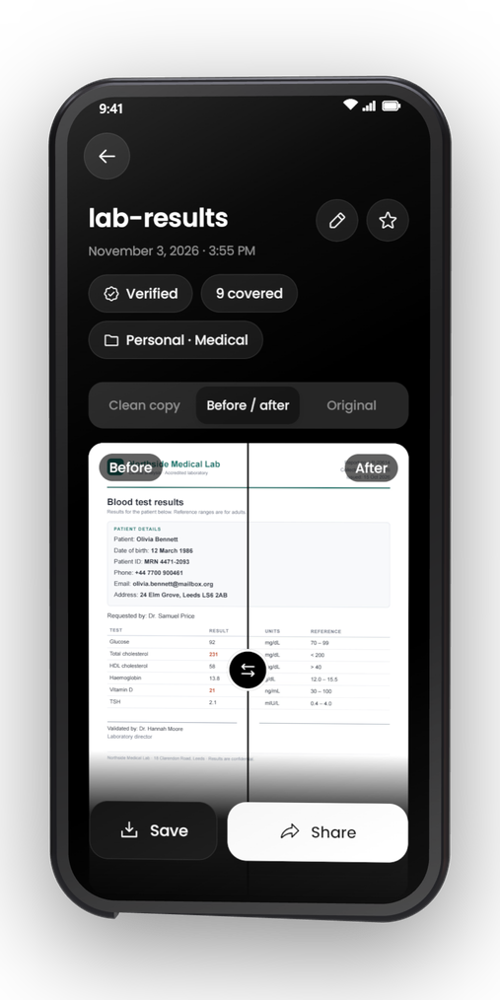
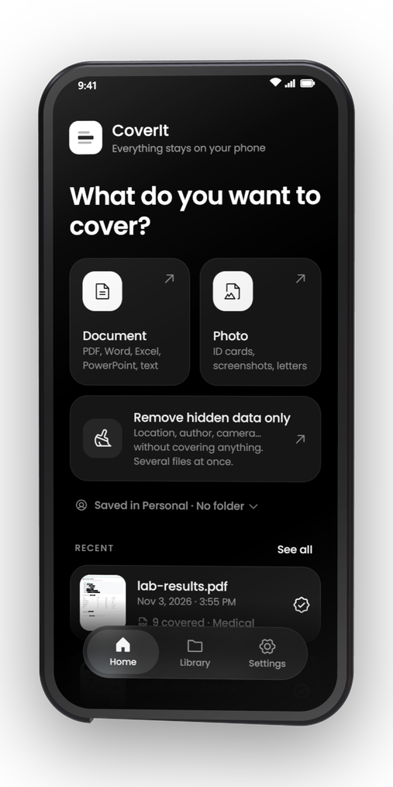
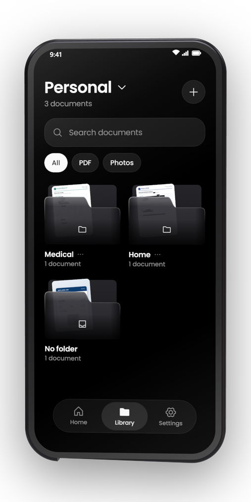
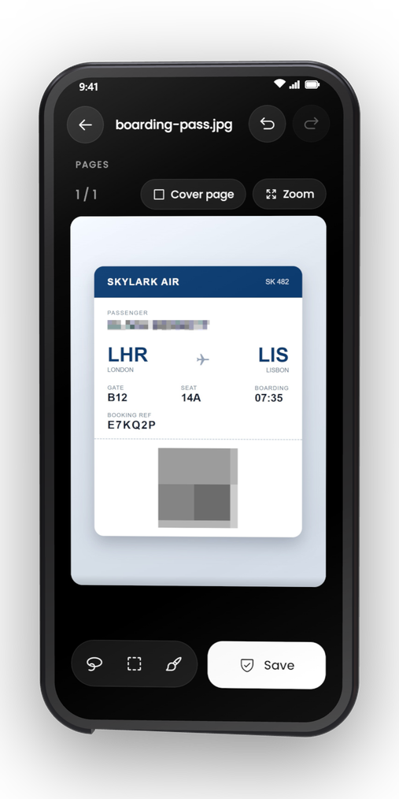
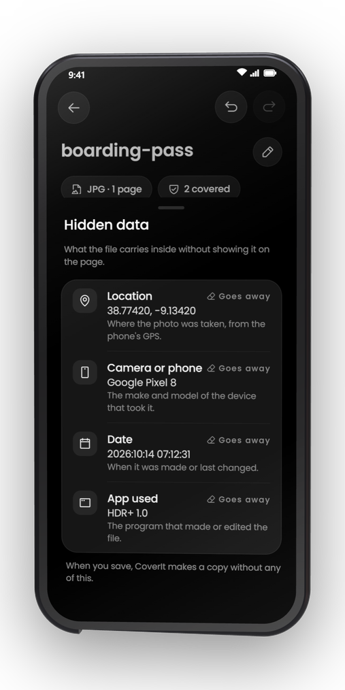

<div align="center">



# CoverIt

**Cover personal data in documents and photos before you share them. Fully offline.**

</div>

<p align="center">
  
  
  
  
</p>

## Why CoverIt exists

Sooner or later you have to send a document, an ID, a contract or a photo, but not everything in it.
Once a file leaves your hands you cannot control what happens to it. It can be kept, read by people
you never meant to reach, or used for purposes you did not agree to, like training an AI. That is why
you cover the confidential parts first: what is not in the file cannot be misused.

A tool that covers your data should not need to see it somewhere else. If it works online or sends
the file to an AI service, the data you wanted to hide from the recipient ends up with the tool
instead. So CoverIt works only on your phone.

It is also useful when you want an AI to analyse or summarise a document: you want the content to
be read, not your name, ID number, IBAN or address.

**The guarantee:** CoverIt has no internet permission. It cannot send anything anywhere, so it is
impossible for it to analyse, copy or leak what is in your files. Everything is done on your phone
and only the clean copy leaves it.

## What it does

- **Finds personal data on its own**: names, ID and account numbers, IBAN, cards, emails, phone numbers from any country, addresses, dates of birth, health details, faces and QR codes. Text in photos and scans is read on the device with OCR. You can teach it your own formats.
- **Lets you decide**: review every item one by one, or cover by hand with the lasso, rectangle or brush. Remove pages and add a watermark. Undo, redo and edit again later.
- **Four cover styles**: black, pixelate, blur, or label (a box that says what was there, like `[NAME]`).
- **Erases for real**: in PDFs the covered text no longer exists in the file. Word, Excel, PowerPoint and LibreOffice files keep their format. The copy is checked again before you share it.
- **Removes hidden data**: author, comments, tracked changes, photo GPS location and camera details. You can also clean one or many files without covering anything.

Opens PDF, Word, Excel, PowerPoint, LibreOffice, plain text and photos, from the app or the Android share menu. English and Spanish, light and dark theme.

> [!NOTE]
> **CoverIt is in beta.** Detection can miss things or mark things that are not personal, so always look over the copy before you share it. If you find a bug or an error, please report it in the [issues](https://github.com/InlitX/CoverIt/issues) so the app keeps improving.

<p align="center">
  
  
  
  
</p>

## Typical uses

- Send a contract, invoice or medical report without exposing the personal details in it.
- Share an ID or a boarding pass keeping only what the other person needs.
- Prepare a document for an AI assistant without confidential data.
- Remove the location and camera details from a photo before posting it.

## Privacy

No internet permission, no analytics, no ads, no account. Your documents never leave your phone and are excluded from Android backups.

## Download

Get the APK from the [releases page](https://github.com/InlitX/CoverIt/releases). Almost every current phone needs `CoverIt-arm64-v8a.apk`.

## Building

Requirements: JDK 17 and the Android SDK.

```
./gradlew assembleRelease
./gradlew testDebugUnitTest
```

Want to help or report a bug? Open an [issue](https://github.com/InlitX/CoverIt/issues) or see [CONTRIBUTING.md](CONTRIBUTING.md).

## Built with

- [PdfBox-Android](https://github.com/TomRoush/PdfBox-Android): reading and writing PDF
- [Tesseract4Android](https://github.com/adaptech-cz/Tesseract4Android): OCR
- [TensorFlow Lite](https://www.tensorflow.org/lite) with MediaPipe's BlazeFace model: faces
- [ZXing](https://github.com/zxing/zxing): QR and bar codes
- [libphonenumber](https://github.com/google/libphonenumber): phone numbers

## License

[GPL-3.0](LICENSE). CoverIt is free and will stay free. If it helps you, you can [buy me a coffee](https://ko-fi.com/inlitx).
